<p align="center">
  
</p>

<p align="center">
  
</p>

<p align="center">
  
  
  
  
  <a href="https://roadmap.sh/projects/markdown-note-taking-app"></a>
</p>

# 📝 Markdown Note-taking App

A lightweight backend, written in **Java**, for taking notes in Markdown — save a note as raw Markdown text, get back a list of everything you've saved, render any note as HTML, and check a note's grammar, all through a small REST API.

**Project URL:** https://roadmap.sh/projects/markdown-note-taking-app

<p align="center"></p>

## 📖 About

### Project Overview

This is a hands-on coding challenge focused on building a simple note-taking backend. The core idea: notes are plain Markdown text, sent to the API and stored on disk. From there, the API can list what's been saved, turn any note into proper HTML, and check it for grammar and spelling issues using an external grammar-checking service.

**Core requirements of the challenge:**

- Provide an endpoint to save a note, passed in as Markdown text
- Provide an endpoint to list all saved notes
- Provide an endpoint that returns the HTML-rendered version of a note
- Provide an endpoint to check the grammar of a note

This README documents how this implementation approaches each of those requirements, and what actually happens when you run it.

## ✨ Features

| Endpoint | Method | Description |
|---|---|---|
| `/notes` | `POST` | Save a new note (Markdown text as the request body) |
| `/notes` | `GET` | List the IDs of every saved note |
| `/render/<noteId>` | `GET` | Render a saved note as HTML |
| `/check-grammar/<noteId>` | `GET` | Check a saved note's grammar and spelling |

<p align="center">
  
</p>

- 📄 Notes are saved as plain `.md` files on disk — easy to inspect, back up, or edit by hand
- 🔄 Markdown → HTML rendering powered by the **commonmark-java** library (standard, spec-compliant output)
- ✅ Grammar and spelling checks powered by the **LanguageTool** public API — catches things like subject-verb agreement, confused words, and missing apostrophes
- 🕒 Simple, collision-free note IDs based on save timestamp
- 🚦 Proper HTTP status codes throughout: `201` on save, `404` for an unknown note, `405` for an unsupported method, `502` if the grammar service can't be reached

<p align="center"></p>

## 🔁 How It Works

1. You send a `POST /notes` request with your note's Markdown text as the raw body.
2. The server saves that text to a new `.md` file inside a local `notes/` folder, named with a timestamp-based ID (e.g. `note-1790509445082`), and returns that ID.
3. A `GET /notes` request scans the `notes/` folder and returns every saved note's ID.
4. A `GET /render/<noteId>` request loads that note's file, parses the Markdown with commonmark, converts it to HTML, and returns it with a `text/html` content type — so it looks right straight in a browser.
5. A `GET /check-grammar/<noteId>` request loads that note's file and forwards its text to the LanguageTool API, which returns a JSON report of grammar and spelling issues, which is passed straight back to you.
6. Any request for a note ID that doesn't exist returns a `404`. Any unsupported method on an endpoint returns a `405`.

<p align="center">
  
</p>

## 💻 Sample Run

<p align="center">
  
</p>

<details>
<summary>Click to read the sample run as plain text</summary>

```
$ gradle run
Server started on port 8080
```

```
$ curl.exe -X POST http://localhost:8080/notes -d "He go to school everyday. She dont like it."
Saved as note-1790509445082

$ curl.exe http://localhost:8080/notes
note-1790509445082

$ curl.exe http://localhost:8080/render/note-1790509445082
<p>He go to school everyday. She dont like it.</p>

$ curl.exe http://localhost:8080/check-grammar/note-1790509445082
{"software":{"name":"LanguageTool", ...},
 "matches":[
   {"message":"The pronoun 'He' is usually used with a third-person...",
    "shortMessage":"Agreement error", "replacements":[{"value":"goes"}], ...},
   {"message":"'Everyday' is an adjective. Did you mean 'every day'?", ...},
   {"message":"Possible spelling mistake found.",
    "replacements":[{"value":"don't"}], ...}
 ]}
```

</details>

## 🛠 Tech stack

- **Java 11+**
- **Gradle** — build tool and dependency manager
- `com.sun.net.httpserver.HttpServer` — for running the API server itself
- `java.net.http.HttpClient` — for calling the LanguageTool API
- [`commonmark-java`](https://github.com/commonmark/commonmark-java) — for parsing and rendering Markdown to HTML
- [LanguageTool API](https://languagetool.org/http-api/) — for grammar and spelling checks

<p align="center"></p>

## 🚀 Getting Started

### Prerequisites

- JDK 11 or later
- Gradle (or use the included setup — see below)
- An internet connection (required for the grammar-check endpoint, and for Gradle to fetch dependencies the first time)

### Build

```bash
gradle build
```

This downloads the `commonmark` dependency and compiles the project.

### Run

```bash
gradle run
```

The server starts on **port 8080**.

## 📡 Usage

### Save a note

```bash
curl.exe -X POST http://localhost:8080/notes -d "# Hello World`n`nThis is **bold** and this is *italic*."
```

Returns the note's ID, e.g. `Saved as note-1790509445082` — each note gets a new, timestamp-based ID, so yours will look different every time you save one.

### List saved notes

```bash
curl.exe http://localhost:8080/notes
```

### Render a note as HTML

```bash
curl.exe http://localhost:8080/render/<noteId>
```

Replace `<noteId>` with the ID you got back when you saved the note (e.g. `note-1790509445082`).

### Check a note's grammar

```bash
curl.exe http://localhost:8080/check-grammar/<noteId>
```

## 📁 Project Structure

```
.
├── build.gradle           # Dependencies, plugins, and build configuration
├── settings.gradle        # Project name
├── src/
│   └── main/
│       └── java/
│           └── app/
│               └── App.java   # Server setup and all four endpoints
└── notes/                 # Created automatically at runtime — saved notes live here
```

<p align="center"></p>

## 🧠 What I Learned

<details open>
<summary>Building this project helped me understand:</summary>

- Setting up and understanding a Gradle project — dependencies, plugins, and tasks — after having only used plain `javac`/`jar` before
- Reading a raw request body from `HttpServer` and using it as arbitrary input (not just query parameters)
- Reading from and writing to the filesystem as a simple storage layer for a REST API
- Using a real Markdown library (`commonmark-java`) instead of writing a parser from scratch
- Calling an external HTTP API (LanguageTool) from within a request handler, and why setting connect/request timeouts matters — without one, a slow or unresponsive upstream service can hang a request indefinitely
- A subtle but important habit: always closing the `OutputStream` after writing an `HttpExchange` response — otherwise the client never learns the response is complete and hangs waiting
- Keeping multiple `createContext` route registrations as siblings in `main()`, rather than accidentally nesting one inside another's handler

</details>

---

Project reference: https://roadmap.sh/projects/markdown-note-taking-app

<p align="center">
  
</p>